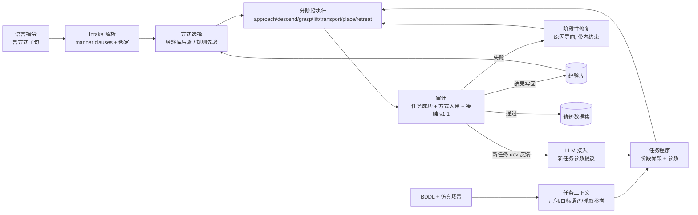

# MannerCAP 上游数据引擎：CVPR Method 写作用进度总结（2026-11-03）

> 范围：方法上游（数据引擎），覆盖三项：(1) 新任务扩展性（LLM 接入）；(2) 经验库；(3) 阶段性失败修复。基准：LIBERO-10。
> 代码分支 `work/experience-library-6phase-20260928`，HEAD 4efe58c。下文数字均已在服务器上用原始记录复核。
> 每个数字都标了数据划分：**[held-out]** 为未参与任何调参的初始状态；**[dev]** 为开发/调参所用；**[预注册]** 表示协议在执行前写好并记录了 git hash；**[事后]** 表示看过结果后做的修改；**[离线回放]** 表示在预先算好的响应网格上回放，没有新的仿真。

---

## 0. 一句话结论

- **经验库（目标 2）和阶段修复（目标 3）**：已有预注册的在线仿真主结果，加上离线学习曲线，证据链基本成型，可以作为 CVPR Method/Experiments 的主体。
- **扩展性（目标 1）**：LLM 闭环接入在 4 个新任务上把 held-out 成功率从 0–2/20 提到 18–20/20，效果显著。但有三点不足：
  - 没有视觉输入；
  - 3 个铰接任务尚未支持；
  - 新任务的"无异常接触"在修复前为 0。

  因此这部分目前**可以写进论文，但还不足以单独成为强贡献**。
- **整体判断**：上游部分已接近 CVPR 可投状态，但要达标还差几项（第 6 节）：
  - 下游 VLA 训练收益实验（审稿人几乎必问）；
  - 统一的 LIBERO-10 主表；
  - 外部基线；
  - 视觉辅助接入（用户明确要求）。

---

## 1. 方法总体框架（写 Method 3.1 用）

**核心组成**

1. **阶段骨架**：每个 pick-place 实例分为 approach / descend / grasp / lift / transport / place / retreat 七个阶段。阶段级快照支持从失败阶段恢复（resume）。
2. **方式的定义（可测量的带）**：
   - 握力用持握力 hold force 衡量：gentle 8–16 N，normal 16–24 N，firm 24–34 N；
   - 速度用阶段实测速度衡量：slow < 0.09，normal 0.09–0.17，fast > 0.17 m/s。

   一条轨迹"遵从方式"的定义：每个方式子句对应的实测量都落在请求的带内。
3. **执行参数**：
   - LIBERO 夹爪动作是符号量化的，力度不能直接给数值。因此握力通过闭合计划 `(lo, hi)` 间接控制，即闭合停止阈值与上限脉冲。候选集合为 10 个：(1,22)(1,100)(5,100)(10,22)(10,100)(15,100)(20,100)(25,100)(30,100)(40,100)。
   - 速度通过阶段速度命令控制，三个梯级为 slow {0.06,0.05,0.04}、normal {0.12,0.10,0.15}、fast {0.24,0.32,0.40}。
4. **审计**。联合通过（joint pass）必须同时满足三项：
   - 所有方式子句入带；
   - LIBERO 官方成功判定为真；
   - 接触策略 v1.1 判为 clean，即没有手/指与非目标物体或支撑面的异常接触。
5. **语言 intake**：把自然语言（中/英、改写）解析为方式子句并绑定到对象实例。早期 intake v3.1 的接受率为 19/20，误接受 0/18 **[held-out]**。

---

## 2. 目标 1：扩展性——为什么新任务成功率低，以及 LLM 接入

### 2.1 诊断：新任务失败的根因（Method 动机段可直接引用）

逐任务排查后的结论：新任务失败**不是因为缺少动作原语**，而是三类"场景/物体特定知识"缺失。

| 根因类别 | 典型案例 | 证据 |
|---|---|---|
| 抓取参考缺失 | T4 需要来自示教的抓取参考，否则手中持握不稳；T8 需要倾斜抓取、全位姿参考，以及对规划器否决的处理 | step 23/26 |
| 放置几何/语义错误 | T5 书本放置时，物体原点与碰撞中心不对齐；释放语义也会影响官方 `on/in` 判定 | step 14/26 |
| 搬运/放置的接触 | 搬运高度不足导致手指刮碰篮筐边沿（27 N 冲击），持握力随之下凹 | step 5 |
| 铰接/固定件操作 | T2 开灶、T3 关闭、T9 关微波炉：需要铰接原语 | 已由系统正确声明不支持 |

由此得出方法设计：**保持原语与执行器不变，把新任务需要的知识表示为"程序参数 + 抓取参考"，由 LLM 根据结构化上下文提议，再用仿真 dev 反馈闭环修正。**

### 2.2 LLM 接入方法（llm_loop）

- **上下文**（`scripts/mt/s26_context.py`）全部从仿真器和 BDDL 中读取，没有任何逐任务常量：
  - 指令；
  - 官方目标谓词及其精确语义（如 `on(obj, region_site)` 的判定不等式，转写自 LIBERO 源码）；
  - 每个可动物体的类别、世界位姿和碰撞 AABB；
  - 每个目标（物体或区域 site）的位姿、半尺寸和下方支撑面；
  - 执行器能力注册表；
  - 参考库中相关物体类别的抓取参考。
- **LLM 输出**：只输出参数补丁（`program_patch.py`，params-only），包括放置位置、顺序、高度、抓取参考选择/网格等。不生成代码，也不新增原语。
- **闭环**：dev 初始状态（0–3）执行后，把失败阶段与失败原因反馈给 LLM，进入下一轮；dev 达标后冻结，再在 held-out 上评测。
- **能力边界**：目标谓词为 open/close/turnon/turnoff 时，LLM 必须声明不支持，不得硬做。

### 2.3 结果 [held-out：inits 10–29，n=20；dev：inits 0–3]

| 任务 | 模板 held-out | 人工 TaskSpec held-out | llm_loop dev 轮次（/4） | **llm_loop held-out** | 修复前接触 clean | LLM 调用 / tokens |
|---|---|---|---|---|---|---|
| T4 | 0/20 | 5/20 | 1→0→0→4 | **18/20** | 0 | 4 / 54,416 |
| T5 | 0/20 | 0/20 | 3→3→4 | **20/20** | 0 | 3 / 24,692 |
| T6 | 0/20 | — | 至多 4 | **19/20** | 0 | 2 / 38,000 |
| T8 (v3) | 2/20 | — | 0→3→4 | **19/20** | 0 | 3 / 31,127 |

- **正确拒绝**：T2（开灶，1 次调用，3,971 tokens）、T3（close 谓词）、T9（关微波炉），均声明为铰接/固定件任务，不支持。
- **注意事项（需在论文中如实说明）**：
  - T5 在 held-out 上的记录状态为 `stage_timeout:place` 20/20，但官方成功判定为 20/20 成功（放置阶段超时发生在已满足谓词之后）。
  - T8 v1 曾被模板和 LLM 都以"需要开灶"拒绝，但 BDDL 的初始状态已含 Turnon。v3 修正了上下文后才得到上表结果，属于**上下文 bug 修复**。
  - T6 v2c 把"接触 clean"加入 LLM 的 dev 通过准则：8 轮 dev 均为 0/4，held-out 0/20，消耗 118,975 tokens。**这说明 LLM 只做参数提议，无法解决接触问题**，因此改由 2.4 的接触修复单独处理。

### 2.4 新任务接触修复（成功之后再追求 clean）

| 任务 | 协议 | 修复前 held-out | 修复后 held-out |
|---|---|---|---|
| T6（step 27） | 冻结提议（md5 fcd74637）；dev 两轮：4/4 成功 1/4 clean → 4/4 成功 4/4 clean | 19/20 成功，0/20 clean | **20/20 成功，18/20 clean** [held-out：inits 30–49] |
| T8（step 29） | dev 选第 3 轮 | 20/20 成功，0/20 clean | **18/20 成功，18/20 成功且 clean** [held-out：inits 30–49] |

- T6 残留问题：inits 35、40 在放置布丁时左指碰到盘子。
- T8 代价：inits 34、41 丢失成功（approach_infeasible）。配对比较中，有 18 个 init 只在修复后成立。
- T4、T5 的接触 clean **尚未修复**。

### 2.5 语言泛化（支撑扩展性）

- 改写/中文指令测试（step 31）：v1 60/85 → v2 76/85（英文 35/35，中文 41/50）；T6 补充测试 8/8。
- v3 为事后修改，结果无变化。
- 金标准由作者编写，**不是独立人工标注**。

### 2.6 关于"视觉辅助"：当前状态

- **目前没有视觉输入。** LLM 只看到文本、几何、BDDL 和示教抓取参考。
- 现有失败中，视觉最可能带来收益的两类：
  1. 接触/间隙判断：手指与容器边沿、盘子的余量；
  2. 抓取姿态选择：T4/T8 这类物体形状不规则或需要倾斜抓取的情况。
- 具体行动见第 6 节 A1。

---

## 3. 目标 2：经验库——生成越多，失败越少、选择越合理

### 3.1 方法（可直接写成公式）

**经验记录**：每次执行都写回一条记录
$r=(\text{task},\ \text{object},\ f=(lo,hi),\ v_{cmd}) \rightarrow (h_{min}, h_{max}, \bar h,\ \text{stable},\ \text{task\_ok},\ \hat v)$。
记录中不使用 init 信息，因为 init 正是请求之间变化的部分。

**预测（分层回退）**：对候选配置 $c=(f, v)$，按以下顺序检索记录集合 $S(c)$，取第一个非空层：
- 同物体 + 同配置；
- 同物体 + 同力；
- 任意物体 + 同配置。

**通过概率**：以规则先验为中心的 Beta 后验均值：
$$
\pi_0(c)=\text{clip}\Big(\exp\big(-((\min(lo+8,hi)-\mu_F)/w_F)^2\big)\cdot \rho(v),\ 0.05,\ 0.95\Big),\quad \rho(v)=0.9\ \text{if}\ v\in B_v\ \text{else}\ 0.05
$$
$$
\hat p(c)=\frac{2\pi_0(c)+\sum_{r\in S(c)}\mathbb{1}[\text{pass}(r)]}{2+|S(c)|}
$$
其中：
- $\text{pass}(r)$ 表示 $h_{min},h_{max}\in B_F$、稳定、任务成功、实测速度 $\hat v\in B_v$ 同时成立；
- $\mu_F,w_F$ 是力带的中心与半宽；
- 规则先验来自物理直觉：闭合在 $lo$ 处停止，因冲击过冲，持握力约为 $lo+8$ N，且不超过 $hi$。

**选择**：按 $\hat p(c)$ 降序排列候选，从首个开始执行。

实现：`scripts/mt/s25_policies.py`；在线版本在 `s30_manner_gen.py` 中。

### 3.2 证据 A：离线学习曲线（step 25 / 28）[离线回放]

**响应网格**
- T0/T1/T7 × 40 inits × 10 闭合计划 × 3 速度（0.06/0.12/0.24），共 3,600 个真实仿真 episode；
- 每个任务每个随机种子生成 480 个请求的流，共 10 个种子，每个请求预算 3 次执行；
- 请求只在网格上查表，不再新增仿真。

| 任务 | 策略 | 首次通过 | 最终通过 | 每请求失败次数 |
|---|---|---|---|---|
| T0 | fixed | 0.247 | 0.497 | — |
| T0 | rule + next | 0.419 | 0.755 | — |
| T0 | rule + cause | 0.419 | 0.998 | 0.84 |
| T0 | **library + cause** | **0.959** | 0.995 | **0.072** |
| T0 | library_xinit（隐藏同 init 记录） | 0.959 | — | — |
| T7 | rule / library + cause | 0.5 / **0.986** | — | — / 0.06 |
| T1 | rule / library + cause | 0.501 / **0.973** | — | — |

**"越来越合理"的直接证据：按请求流四等分（Q1→Q4），library + cause**
- 力误差 0.514 → 0.400；
- 力入带率 0.934 → 1.0；
- 首次通过 0.927 → 0.996；
- 作为对照，rule + cause 各分位基本持平，约 0.47。

**收敛后的首选配置合理（T0 举例）**
- R2 收敛到 (5,100)，96/96；
- R4 收敛到 (40,100)；
- R1 收敛到 (1,100) 或 (1,22)。

**跨任务迁移（step 28）**：协议在仿真前写定，过程中无调参；T6 视马克杯为易碎物；使用新的 held-out 网格，T6 inits 0–29，共 900 个 episode；每个种子 108 个可满足请求。

| 策略 | 首次通过（/108） | 最终通过（/108） | 失败执行总数 |
|---|---|---|---|
| rule + cause | 45 | 105.0 | 735 |
| library_empty + cause（从空库开始） | 98.3 | 107.4 | 677 |
| library_xtask + cause（预载 T0/T1/T7 经验） | **99.9** | **107.9** | **674** |

- 首次通过率按 15 个窗口的曲线：
  - rule：在 0.3–0.55 间平坦；
  - library_empty：0.58 → 0.67 → 0.85 → 0.95 → … → 约 0.97；
  - library_xtask：0.65 → 0.80 → 0.90 → …
- **这是"生成越多、失败越少"的主图候选。** 跨任务预载主要在早期起作用；有写回时，各变体最终都会收敛。
- **修复 v3 "member" 规则**（`protocol_repair_v3.json`，按预先声明的采纳规则）：rule + member 107.3 对 rule + cause 105.0，误停 0。失败的变体 rule + resp 只有 59.1，且误停 48.9。

### 3.3 证据 B：预注册在线仿真主实验（step 30）[预注册，held-out]

**设置**
- 协议 `step30_manner_formal.v1`，在任何正式执行前写定，git 548b0b2，记录了代码 sha256。
- 任务 T0/T1/T7/T6/T8；inits 42–49，与网格和 pilot 均不相交，且同场景的库记录被隐藏。
- 11 个指令模板：neutral、gentle_X、firm_X、slowcarry_X、fastcarry_X、gentle_slow_X、firm_fast_X、Xgentle_Yfirm、Xfirm_Ygentle、slow_approach、slow_all。
- 每个条件 440 个 case，每个 case 预算 3 次执行。
- 主指标：联合通过（所有方式子句入带，且任务成功，且接触 v1.1 clean）。

| 条件 | 首次联合通过 | 最终联合通过 | 总执行数 | 每次成功所需执行数 |
|---|---|---|---|---|
| **full**（冻结库 + 带内修复） | **245/440 = 55.7%** [51.0, 60.3] | **255/440 = 58.0%** [53.3, 62.5] | **566** | **2.22** |
| nolib（规则先验 + 原因导向修复） | 158/440 = 35.9% [31.6, 40.5] | 245/440 = 55.7% [51.0, 60.3] | 751 | 3.07 |
| no_repair（= full 的首次执行） | 245/440 | 245/440 | 440 | — |

方括号内为 Wilson 95% 置信区间。

**统计检验**
- full vs nolib 最终结果：full_only 11，nolib_only 1，McNemar 精确检验 p = 0.0063；
- 执行次数减少 24.6%（566 vs 751）。

**分子句结果**

| 子句 | full 首次 / 最终 | nolib 首次 / 最终 |
|---|---|---|
| grip:gentle（n=160） | **108 / 123** | **3** / 114 |
| grip:firm（n=160） | 135 / 134 | 89 / 123 |
| speed:slow（n=640） | 610 / 610 | 610 / 610 |
| speed:fast（n=80） | 78 / 78 | 78 / 78 |

**说明**
- 经验库的作用主要体现在**握力**上：规则先验在 gentle 请求上首次几乎全错（3/160），经验库首次就达到 108/160。
- 速度命令基本 1:1 实现，规则先验已足够。

**相对关系检验**（方式是否"可区分"，full vs nolib）
- hold(gentle_X) < hold(firm_X)：**39/39** vs 31/39；
- 多物体绑定 hold(gentle 物体) < hold(firm 物体)：**74/74** vs 64/74；
- 搬运速度 slowcarry < neutral < fastcarry：39/39 vs 39/39。

**按任务（full，首次 / 最终 / 执行数，每任务 n=88）**

| 任务 | 首次 | 最终 | 执行数 |
|---|---|---|---|
| T0 | 32 | 34 | 102 |
| T1 | 29 | 29 | 114 |
| T6 | 67 | 67 | 130 |
| T7 | 53 | 53 | 92 |
| T8 | 64 | 72 | 128 |

**full 条件下的失败分布**（185 个未通过 case）
- 接触不 clean（不是方式失败）：94；
- 预算用尽：28；
- 力候选耗尽（方式不可行，诚实停止）：28；
- 任务失败（不是方式失败）：25；
- 速度梯级耗尽：10。

按任务看：
- 接触失败集中在 T0（40）、T7（33）、T1（21）；
- T1 另有 15 次任务失败和 10 次速度梯级耗尽。

**结论**：剩余瓶颈主要是**任务级接触**，而不是方式选择，这引出 4.3 节的阶段修复。

### 3.4 证据 C：经验的扩展——间隙经验（step 31）[事后修正]

- 把搬运间隙（clearance）也作为经验写入，并做 leave-one-scene-out。
- T0 首次通过 32 → 71/88，执行数 139 → 88。
- **这是看过 step 30 结果后加入的，必须标注为事后修正；需要新的预注册 held-out 复验**（见第 6 节）。

### 3.5 更早的旁证

- step 20 选择评测：检索首候选联合通过 24/32，规则 13/32。
- E1：B 首次 29/32 vs A 8/32；尝试次数 37 vs 77。
- step 13 2×2（T0/T7 × inits 26–29 × 4 个请求）：
  - 首选方式正确 28 vs 16（检索 vs 规则）；
  - 联合通过依次为 16/16/19/19，对应 rule/rerun、rule/recover、retr/rerun、retr/recover。
  - 注意：guard/policy 在 inits 26–27 上调过参。
- 旧 robosuite p08b 上经验库无差异，原因是默认参数本来就准。**写作时可作为"经验库只在先验不准时有用"的边界讨论。**

---

## 4. 目标 3：阶段性失败修复——先救成功率，再在方式带内调数值

### 4.1 方法：原因导向、方式带约束的修复

审计给出**失败阶段**和**失败原因**。修复器只沿与原因对应的一根轴移动，且**永远不提出越出请求方式带的值**（`cause_repair`）：

| 失败原因 | 修复方向 | 约束 |
|---|---|---|
| slip / drop / 未抬起 | 力度沿闭合停止阈值升序**上调**；若带顶已到，在速度带内**减速** | 闭合停止阈值 $lo$ 不得超过力带上限 |
| 持握力高于带（force_above_band） | 力度**下调** | — |
| 持握力低于带（force_below_band，任务成功） | 力度**上调** | 仍在带内 |
| 速度出带 | 速度命令朝带内移动 | 只取带内梯级 |
| 其他任务失败 | 在速度带内减速 | — |
| 接触异常（lift/transport 阶段，step 31） | 搬运抬高 +0.03 m，最多 +0.06 m；**方式不变** | 只改任务级几何参数 |
| 无候选剩余 | **诚实停止**（manner-infeasible），不降级方式 | — |

**阶段恢复**：从失败阶段的快照恢复，而不是整条重跑。
- step 8：恢复与整条重跑的结果逐位一致（B==C）；
- 恢复节省 24% 的额外 substep；
- 方法账本口径下约节省 27%（step 13，判定 64/64 一致）。

**用户举的例子在本框架中如何体现（可写进 Method 动机）**
- "轻轻拿起，2 N 失败，改用 5 N 成功"：对应 force_below_band 或 slip 时**在 gentle 带内**上调。

  真实例子：T8 init 42，gentle 物体闭合计划 (1,100)，实测持握 6.9 N（低于 8 N 下限），修复到 (10,22) 后为 15.3 N，入带 [held-out, step 30 nolib]。
- "不要求轻拿时，用 20 N 也合理，并且不会弄坏易碎物"：方式带由**请求**决定。
  - firm 请求允许 24–34 N。例如 T8 init 42 firm 物体，(20,100) 实测 23.9 N 低于带，修复到 (25,100) 后为 32.7 N 入带。
  - 一旦请求是 gentle（例如对易碎物的“轻轻拿”），修复器**不会提出闭合阈值高于 16 N 的候选**；带内找不到可行值就诚实停止，而不是"加大力气保成功"。
- 反方向同样成立，即太用力时下调。T0 init 42，gentle 番茄酱 (5,100) 实测 22.3 N 高于带，修复到 (1,100) 后为 12.5 N 入带。

### 4.2 证据 A：离线修复对比（step 25，T0）[离线回放]

**策略对比**
- rule + cause 最终 0.998，rule + next（盲目换下一个候选）0.755，fixed 0.497。
- 首次失败原因分布（rule）：force_below 363，force_above 322，task_failed_other 90，slip 51。

**修复转移计数**（seed 0）

| 原因 → 动作 | 修复后通过 | 未通过 |
|---|---|---|
| force_above_band → 下调 | 634 | — |
| force_below_band → 上调 | 42 | 321 |
| slip_or_drop → 上调 | 3 | — |

例：T0 init 39，R1 slow，(5,100) 实测 22.4 N，修复到 (1,100) 后为 12.5 N。

**说明**："低于带 → 上调"的成功率低，原因是 LIBERO 夹爪的闭合冲击使最小持握力本身就高于部分组合的下限，可行区间很窄。这正是需要经验库提供先验的地方。

### 4.3 证据 B：在线修复（step 30）[预注册，held-out]

- **修复在先验不准时价值最大**：nolib 首次 158 → 最终 245（+87 个 case）。
- full 条件下首次已经很准，修复只再增加 10 个 case：recovered 10，lost 0，McNemar p = 0.002。
- 修复转移计数（nolib，执行级，入带才计为成功）：
  - gentle 下调入带 90 次；
  - gentle 上调入带 21 次；
  - firm 上调入带 26 次；
  - firm 下调入带 8 次。

### 4.4 证据 C：任务级阶段修复（step 31）[事后修正]

- 由接触证据触发搬运间隙修复，方式不变。
- T0 最终 34 → **70/88**（配对 +36 / −0）；T7 53 → 59。
- 需要预注册的 held-out 复验。

### 4.5 诚实停止

- 不可满足请求的停止标签分三类：force_candidates_exhausted、speed_ladder_exhausted、budget。
- step 28 修复 v3 的误停为 0。
- step 30 full 条件下，"力候选耗尽"28 例，即带内候选全部试完后停止。**系统不会通过越带来换取成功。**

---

## 5. 三项是否达到 CVPR 标准：逐项判断

| 维度 | 现有最强证据 | 达标程度 | 主要短板 |
|---|---|---|---|
| 目标 1：扩展性 / LLM | 4 个新任务 held-out 0–2/20 → 18–20/20；正确拒绝 3 个铰接任务；token 成本已记录 | **中**：有效，但贡献偏工程化 | 无视觉；新任务接触 clean 仅修复了 T6、T8；铰接任务 0/3；与已有 LLM 机器人方法（Code-as-Policies 类）没有对比 |
| 目标 2：经验库 | 预注册在线实验：首次 55.7% vs 35.9%，执行数 −24.6%，McNemar p=0.006；离线曲线单调上升；跨任务迁移 | **较强** | 在线主实验用的是**冻结库**，没有在线写回的学习曲线；"越来越合理"在在线条件下没有直接图；仅覆盖 5 个任务 |
| 目标 3：阶段修复 | nolib +87 个 case；full +10，lost 0；原因导向 0.998 vs 盲目 0.755；恢复与重跑一致且节省约 27% | **较强** | 接触/间隙修复是事后加入，未经预注册复验；易碎性只用持握力定义，**闭合冲击峰值约 37 N 对各档位都存在**，且仿真中没有"破损"判定 |
| 整体 | 上游证据链完整，且 dev / held-out / 预注册划分清楚 | **接近，未达标** | 缺下游 VLA 收益；缺 LIBERO-10 统一主表；外部基线不足 |

**判断**：如果论文定位为"数据引擎方法 + 下游验证"，上游部分（目标 2、3）已经可以写成 Method 的主体；目标 1 可以写成一节"LLM-assisted task onboarding"。**但要达到 CVPR 主会标准，至少还需要完成第 6 节的 P0 项。**

---

## 6. 还差的行动（按优先级，每项附验收标准）

### P0（不做就很难过 CVPR 审稿）

**A0. 下游 VLA 收益实验**（不属于上游，但上游的论点依赖它）
- 当前 LIBERO 路径导出的 npz 只有 state(8)、actions(7)、力、速度、stage，**没有图像，也没有和 pi0.5 导出流程衔接**。
- 行动：
  1. 补齐图像渲染与导出（agentview + wrist），格式与 LIBERO hdf5 / LeRobot 一致；
  2. 在 T0/T1/T6/T7/T8 上生成带方式标签的数据；
  3. 微调一个 VLA（如 pi0.5 或 OpenVLA-OFT）。
- 对比三组：
  - 无方式条件；
  - 方式条件但不用库/修复（nolib 数据）；
  - full 数据。
- 验收：在 held-out inits 上，VLA 的方式遵从率（握力/速度入带）和任务成功率同时报告；full 数据训练的模型显著优于对照。

**A2. 在线写回学习曲线**（目标 2 的核心主张："生成越多越好"）
- step 30 用的是冻结库。需要一个预注册实验：在新任务（建议 T6、T8 或新接入的 T4/T5）上从空库开始在线生成，例如每个任务 ≥ 200 个请求，按窗口报告：
  - 首次通过率；
  - 每次成功所需执行数；
  - 力误差 $|\bar h-\mu_F|$；
  - 所选闭合计划的分布。
- 对照：规则先验 + 修复，以及同样请求顺序下的冻结空库。
- 验收：库曲线单调上升并在 Q4 显著高于对照（置信区间不重叠，或做配对检验）。这张图对应用户的主张"在相同任务或可复用任务上，力度和速度选择越来越合理"。

**A3. 事后修正的预注册复验**
- step 31 的间隙修复和间隙经验，在全新 inits（如 50–69）× T0/T1/T7 × 11 模板上预注册复验。
- 验收：联合通过高于 step 30 full，且配对检验显著。

**A4. LIBERO-10 统一主表**
- 每行一个任务（T0–T9）。列：
  - 支持状态；
  - 任务成功（held-out）；
  - 接触 clean；
  - 方式联合通过（first / final）；
  - 每次成功所需执行数；
  - LLM tokens；
  - 仿真时间。
- 不支持的行写 "declared unsupported"。验收：一张表能回答"覆盖几个任务、每个多好、成本多少"。

### P1（显著增强贡献，用户已明确要求）

**A1. 视觉辅助接入**（目标 1）
- 行动：给 LLM（VLM）加入渲染图像（agentview + 目标区域裁剪），并采用两类用法：
  - **接入前**：用于抓取姿态和放置点提议，与纯文本上下文做对比；
  - **失败后**：根据失败帧的视觉诊断，选择修复轴（例如"手指碰到篮筐边沿 → 抬高搬运"），与纯数值原因做对比。
- 实验：T4/T5/T6/T8 四个任务 × {text-only, text+vision}，比较：
  - 达到 dev 4/4 所需轮数和 tokens；
  - held-out 成功率；
  - 接触 clean 率。

  另外重新尝试 T6 v2c 的严格接触准则（text-only 时为 0/20）。
- 验收：vision 版本在 dev 轮数 / tokens 上更省，或在 clean 率上更高，且 held-out 不劣化。

**A5. T4、T5 接触修复**
- 复用 step 27/29 的协议，dev 选轮后在 held-out 30–49 上报告"成功且 clean"。
- 验收：T4、T5 都达到 ≥ 15/20 成功且 clean。

**A6. 易碎性与峰值力**（回应"不会把易碎物品搞坏"）
- 当前方式只约束持握力，闭合冲击峰值约 37 N 在所有档位都会出现。
- 行动：
  1. 对 gentle 请求加入峰值力上限（v2 标定中已有 peak_cap 字段）或闭合速度控制；
  2. 报告 gentle / firm 两档的峰值力分布；
  3. 定义"破损代理指标"（峰值 > 阈值即判为破损）。
- 验收：gentle 请求的破损代理率显著低于 firm，且修复不会把 gentle 推入破损区。

**A7. 外部基线**
- 至少一个 LLM 代码生成基线（Code-as-Policies 风格，同样的原语 API，无经验库、无修复），以及 "LLM 直接给数值力/速度" 的基线。
- 验收：与本方法在同一请求集上比较联合通过率和执行数。

### P2（加分 / 写作完整性）

- **A8. 铰接任务 T2/T3/T9**：实现 open/close/turn 原语（旋钮转动、门铰链拉推），使 LIBERO-10 覆盖到 10/10。做不到也可以作为"诚实拒绝"写进论文的局限性。
- **A9. 独立人工改写集**：请不参与开发的人员写 ≥ 100 条中英文方式指令，报告 intake 准确率和误接受率。
- **A10. 成本账本**：统一报告每条成功轨迹的仿真 wall time、LLM tokens、人工工时（目前只有部分记录，如 T5 的 37 回合 sim_wall 261.9 s）。
- **A11. 消融表汇总**：
  - 库：full / nolib / xtask / empty；
  - 修复：cause / next / member / none；
  - 恢复：resume / rerun；
  - 接入：template / human / llm / llm+vision。

  每行都要注明数据划分。

---

## 7. Method 写作建议结构与"可以说 / 不能说"

### 7.1 建议章节

1. **3.1 Problem**：给出方式条件化的轨迹生成定义，包括方式子句、可测量的带、联合通过。
2. **3.2 Stage-structured task programs**：阶段骨架、参数化程序、阶段快照。
3. **3.3 LLM-assisted task onboarding**：结构化上下文（几何 + 谓词语义 + 抓取参考），只提议参数，用 dev 闭环，能力边界外拒绝；接触修复作为第二阶段。（A1 完成后加入视觉）
4. **3.4 Experience-driven manner selection**：3.1 节的公式；分层回退；写回。
5. **3.5 Cause-directed, manner-bounded stage repair**：4.1 节的表；诚实停止；阶段恢复。
6. **3.6 Auditing**：方式入带、官方成功判定、接触 v1.1。

### 7.2 可以说

- "在 4 个新 LIBERO-10 任务上，LLM 接入把 held-out 成功率从 0–2/20 提到 18–20/20，并正确拒绝 3 个超出能力的任务。"
- "预注册的 440 个 case 在线实验中，经验库把首次联合通过从 35.9% 提到 55.7%，执行数减少 24.6%。"
- "原因导向、带约束的修复在先验不准时挽回 87/440 个 case，且从不越出请求的方式带。"
- "离线请求流上，首次通过随生成量单调上升（T6：0.58 → 0.97），力误差下降。"

### 7.3 不能说（或必须加限定）

- 不能说"视觉辅助"：目前没有。
- 不能说"支持全部 LIBERO-10"：目前任务成功覆盖 T0、T1、T4–T8 共 7 个，其中有方式生成的只有 5 个。
- 学习曲线若只来自 step 25/28，必须写明是"在预计算的仿真响应网格上回放"。
- step 31 的 T0 34 → 70 必须写明是事后修正，除非 A3 已完成。
- 不能说"不会损坏易碎物"，除非 A6 已完成。目前只能说"持握力在请求带内"。
- 改写测试的金标准由作者编写，A9 完成前不能称为"人类指令泛化"。

---

## 8. 数据与代码索引

| 内容 | 路径 |
|---|---|
| LLM 上下文 / 参数补丁 / 抓取参考 | `scripts/mt/s26_context.py`、`program_patch.py`、`grasp_references.py`、`configs/grasp_references.v1.json` |
| 经验库与修复策略（离线） | `scripts/mt/s25_policies.py`、`reports/step25_response_grid/` |
| T6 迁移 | `reports/step28_t6_manner/`（含 `protocol_repair_v3.json`） |
| 在线正式实验 | `scripts/mt/s30_manner_gen.py`、`scripts/mt/s30_formal_metrics.py <formal_dir>`、`reports/step30_manner_gen/formal/` |
| 接触策略 | `synthesis_v2/contact_policy_v1.py` |
| 接触修复 T6 / T8 | `reports/step27_t6_repair/`、`reports/step29_t8_contact/` |
| 改写与间隙（step 31） | 提交 4efe58c |
| 轨迹度量（SPARC/LDLJ/Cohen's d/AUC） | `synthesis_v2/manner_trajectory_metrics.py` |
