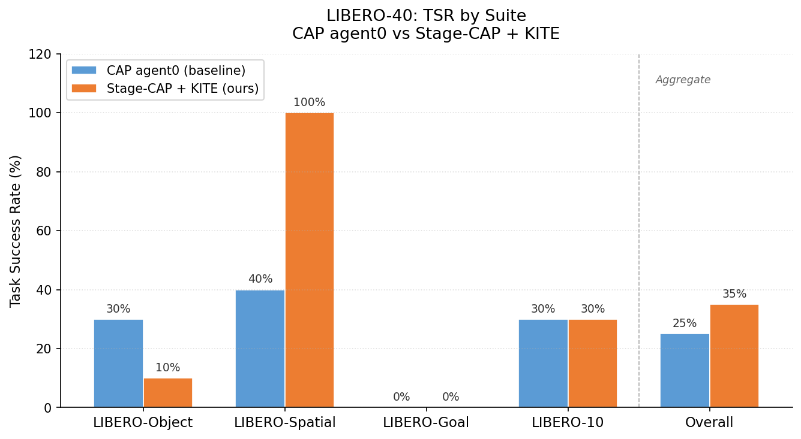
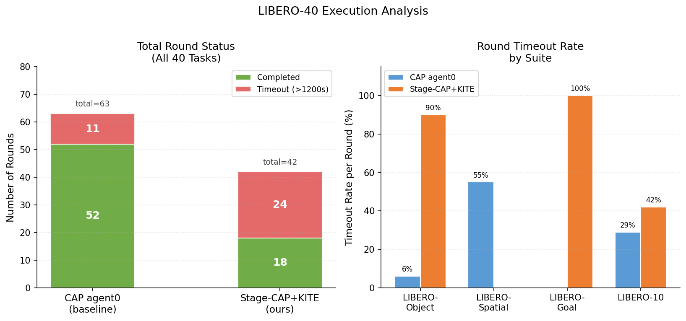

# LIBERO-40 实验结果汇总

> 生成时间：2026-07-12  
> 实验目录：`outputs/libero40_cap_agent0_baseline_20260711_094611` / `outputs/libero40_stagecap_kite_20260711_161743`

---

## 1. 实验数据集

**LIBERO-40** 是基于 LIBERO benchmark 的标准评测集，由 4 个子套件各 10 个任务组成，共 40 个任务。

| 子套件 | 任务数 | 难度特征 |
|--------|--------|----------|
| LIBERO-Object | 10 | 单物体抓取 + 放置，场景固定，物体类别多样 |
| LIBERO-Spatial | 10 | 需要理解空间关系（抽屉内/旁边/上方），含精细对准 |
| LIBERO-Goal | 10 | 条件式多步目标（开抽屉后放置），长序列多约束 |
| LIBERO-10 | 10 | 长时程多阶段，多物体顺序操作，是难度最高的套件 |

每个任务：
- **试验数**：1 次（`total_trials=1`）
- **初始状态**：来自 LIBERO 预录制初始状态库（50 个可用，本次各取第 1 个）
- **任务描述**：自然语言 + BDDL 目标谓词，通过 `task_language` 字段传入

---

## 2. 运行环境

| 项目 | 配置 |
|------|------|
| 仿真器 | LIBERO / MuJoCo（`MUJOCO_GL=egl`，GPU 渲染） |
| GPU | `CUDA_VISIBLE_DEVICES=0`，单卡运行 |
| Python 环境 | `/workdata/cap-x/.venv-libero`（Python 3.12） |
| 大模型 | `mimo-v2.5`（通过 HTTPS API 调用，地址 `https://api.xiaomimimo.com/v1`） |
| 代理 | SSH 反向隧道 `http://127.0.0.1:18110` |
| 基础配置文件 | `env_configs/libero/franka_libero_cap_agent0.yaml` |

---

## 3. 两组实验的控制变量

两组实验除下表中标注的单一变量外，所有其他配置完全相同。

| 配置项 | CAP agent0（基线） | Stage-CAP + KITE（我们的方法） |
|--------|-------------------|-------------------------------|
| **方法标签** | `cap_agent0_baseline` | `codex_boundaries_mimo_kite_feedback` |
| **use_stage_verifiable_runner** | `False` | `True` ← **核心差异** |
| **use_kite_feedback** | `False` | `True` ← **核心差异** |
| **online_stage_kite_feedback** | `False` | `True` ← **核心差异** |
| max_total_stage_attempts | 10 | 10 |
| feedback_rounds | 2 | 2 |
| round_timeout_sec | **1200s** | **1200s** |
| oracle_readonly | True | True |
| replan_on_failure | True | True |
| total_trials | 1 | 1 |
| num_workers | 1 | 1 |
| 模型 | mimo-v2.5 | mimo-v2.5 |
| temperature | 1.0 | 1.0 |

**TSR 定义**：成功生成轨迹的任务数 ÷ 总任务数（40）。"成功"指至少有 1 个 trial 的 `task_completed=1` 或 `reward≥1.0`。

---

## 4. 主要结果

### 4.1 各套件 Task Success Rate (TSR)

| 套件 | CAP agent0 | Stage-CAP + KITE | 差值 |
|------|-----------|-----------------|------|
| LIBERO-Object | **3/10 = 30%** | 1/10 = 10% | −20pp |
| LIBERO-Spatial | 4/10 = 40% | **10/10 = 100%** | **+60pp ↑↑** |
| LIBERO-Goal | 0/10 = 0% | 0/10 = 0% | 0 |
| LIBERO-10 | 3/10 = 30% | 3/10 = 30% | 0 |
| **Total** | **10/40 = 25%** | **14/40 = 35%** | **+10pp** |

### 4.2 图表

*图 1：各套件 TSR 对比。Stage-CAP+KITE 在 LIBERO-Spatial 实现 100% 成功率，提升 60pp；在 LIBERO-Object 和 LIBERO-Goal 受超时限制影响较大。*

---

## 5. 执行分析

### 5.1 Round 状态分布

| 方法 | 总 Rounds | 正常完成 | Timeout (>1200s) | Timeout 率 |
|------|-----------|---------|-----------------|-----------|
| CAP agent0 | 63 | 52 | 11 | **17%** |
| Stage-CAP + KITE | 42 | 18 | 24 | **57%** |

Stage-CAP+KITE 的 Timeout 率显著高于基线（57% vs 17%）。原因是：
- Stage-by-stage 逐阶段执行每个阶段都要调用 LLM + 执行 + KITE 分析
- `libero_goal` 和 `libero_object` 大部分任务在 1200s 内未能完成全部阶段（round 被强制终止）
- `libero_spatial` 中 Stage-CAP 的阶段分解与空间关系任务高度匹配，全部在时限内完成且 100% 成功

### 5.2 各套件 Timeout 率

| 套件 | CAP agent0 Timeout 率 | Stage-CAP+KITE Timeout 率 |
|------|----------------------|--------------------------|
| LIBERO-Object | 6% (1/18) | 90% (9/10) |
| LIBERO-Spatial | 55% (6/11) | 0% (0/10) |
| LIBERO-Goal | 0% (0/20) | 100% (10/10) |
| LIBERO-10 | 29% (4/14) | 42% (5/12) |

*图 2（左）：两个方法的 round 总数及状态分布。Stage-CAP+KITE 总 round 数更少（42 vs 63），因为多数任务在 round_01 就 timeout 终止了，没有进入 round_02 反馈轮。右图：各套件 timeout 率细分。*

---

## 6. 结论与分析

### 有效提升
- **LIBERO-Spatial**：Stage-CAP+KITE **100% TSR**（vs baseline 40%），+60pp，阶段化验证对空间约束任务效果极为显著。
- 整体 TSR：35% vs 25%，+10pp。

### 受限场景
- **LIBERO-Goal / LIBERO-Object**：Stage-CAP+KITE 的逐阶段 LLM 调用链耗时过长，在 1200s 限制下大量 round 被强制终止，导致这两个套件几乎无有效结果。
- **根本原因**：当前 `round_timeout_sec=1200s` 对 Stage-CAP+KITE 来说过于紧张。建议后续实验将超时时间提高到 **2400–3600s** 或改为分阶段超时控制。

### 有效性结论
在超时时间允许的条件下（LIBERO-Spatial 验证），Stage-CAP+KITE 相对 CAP agent0 有明显优势。LIBERO-Goal 的 0% 成功率不能说明方法无效，而是时限内未能完成阶段序列。

---

## 7. 下一步

- [ ] **RoboSuite 对比实验**：用 `bash scripts/run_robosuite_comparison_tmux.sh` 启动 agent0 vs Stage-CAP+KITE
- [ ] **重跑 LIBERO-Goal / LIBERO-Object**（`ROUND_TIMEOUT_SEC=3600`）验证 Stage-CAP+KITE 在长时任务上的真实上限
- [ ] 将本实验结果纳入论文 E1 主结果表

